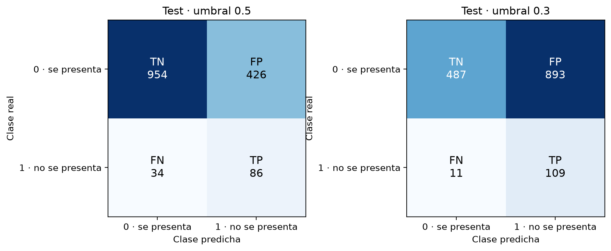
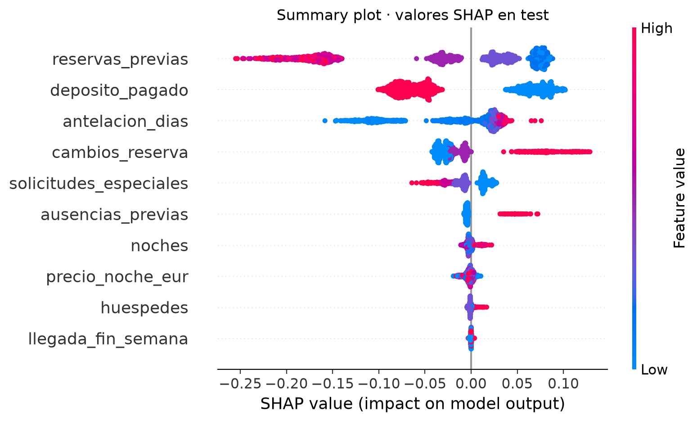

# Reservas de hotel · Predicción de no-shows y explicabilidad

¿Qué clientes no se van a presentar a su reserva? Este proyecto construye un modelo para detectarlos con antelación, de forma que el hotel pueda **priorizar las llamadas de confirmación** sin molestar a demasiados clientes, y después **explica por qué** el modelo toma cada decisión.

Proyecto individual de la asignatura **Proyecto de Ciencia de Datos** del Grado en Ciencia de Datos e Inteligencia Artificial (Universidad Politécnica de Madrid), curso 2026–2027.

| Notebook | Contenido |
|---|---|
| [`01_clasificacion.ipynb`](01_clasificacion.ipynb) | Clasificación con clases desequilibradas, elección del umbral por coste y clasificación de reseñas (multiclase y multietiqueta) |
| [`02_explicabilidad.ipynb`](02_explicabilidad.ipynb) | Selección de variables, modelo interpretable y explicación de un random forest con SHAP |

---

## 1 · Clasificación: qué reservas se quedan vacías

Solo el 8 % de las reservas son no-shows, así que un modelo que diga siempre "se presenta" acierta mucho y no sirve para nada. El trabajo se centra en evitar esa trampa:

- **Métrica elegida antes de comparar:** F1 de la clase positiva, en lugar de accuracy.
- **Tratamiento del desequilibrio:** regresión logística con sobremuestreo aleatorio, submuestreo, ponderación de clases, SMOTE, SMOTENC (respetando las variables binarias) y Tomek Links, todo dentro de un `Pipeline` de `imbalanced-learn` para que el escalado y el remuestreo se ajusten solo con los datos de entrenamiento de cada partición.
- **Validación:** validación cruzada estratificada sobre el entrenamiento; el test se usa una sola vez al final.
- **Umbral de decisión según el coste de negocio:** un no-show no detectado cuesta mucho más que una llamada innecesaria, así que el umbral se elige en validación minimizando ese coste en lugar de usar 0,5 por defecto.

<p align="center">
  
</p>

Con el umbral elegido, el modelo detecta la gran mayoría de los no-shows a cambio de más llamadas de confirmación, que son baratas.

**Reseñas del hotel.** El mismo notebook incluye dos problemas más:
- **Multiclase:** clasificar cada reseña como positiva, neutra o negativa, con métricas por clase y comparación de promedios micro, macro y weighted.
- **Multietiqueta:** detectar qué motivos de queja contiene cada reseña (limpieza, ruido, atención, instalaciones), comparando acierto por decisión, *exact match* y F1 por etiqueta frente a una referencia trivial.

## 2 · Explicabilidad: por qué decide lo que decide

- **Selección de variables:** filtros (correlación e información mutua) y selección hacia delante (*wrapper*) con validación cruzada anidada para comprobar que la selección es estable.
- **Modelo interpretable:** regresión logística con las variables seleccionadas, explicada con sus coeficientes y *odds ratios* y con explicaciones locales de casos concretos (un acierto, un falso negativo y un falso positivo).
- **Modelo no interpretable + SHAP:** un random forest explicado con Tree SHAP: importancia global, *beeswarm*, dependencia, interacciones y explicaciones locales (*waterfall* y *force plot*), comparando SHAP con la importancia por impureza.

<p align="center">
  
</p>

**Conclusiones principales**
- Las reservas previas (fidelidad) y el depósito pagado reducen el riesgo de no-show; los cambios en la reserva y las ausencias anteriores lo aumentan.
- El random forest no mejora a la regresión logística: SHAP muestra que usa las mismas variables, con el mismo signo y con interacciones débiles, es decir, aprendió un modelo casi aditivo. Lo único que añade es el efecto no lineal de la antelación de la reserva.
- La importancia por impureza sobrevalora las variables continuas con muchos valores distintos (como el precio); para explicar el modelo es más fiable la media de |SHAP|.

## Estructura

```
├── 01_clasificacion.ipynb
├── 02_explicabilidad.ipynb
├── data/
│   ├── 01_reservas_hotel.csv
│   ├── 02_reseñas_valoracion.csv
│   ├── 03_reseñas_quejas.csv
│   └── LEEME_datasets.txt      # descripción de las variables
├── figuras/                    # figuras generadas por los notebooks
├── tablas/                     # tablas de resultados generadas por los notebooks
└── requirements.txt
```

## Cómo ejecutarlo

```bash
pip install -r requirements.txt
jupyter notebook
```

Los notebooks se ejecutan de principio a fin (*Restart & Run All*) desde la raíz del repositorio. Las semillas son fijas, así que los resultados son reproducibles.

## Datos

Datos **sintéticos** proporcionados para la asignatura: no corresponden a ningún hotel ni a clientes reales. La descripción de cada variable está en [`data/LEEME_datasets.txt`](data/LEEME_datasets.txt).

## Tecnologías

Python · pandas · scikit-learn · imbalanced-learn · SHAP · statsmodels · Matplotlib

---

**Autora:** Lucía Martínez Miramontes
